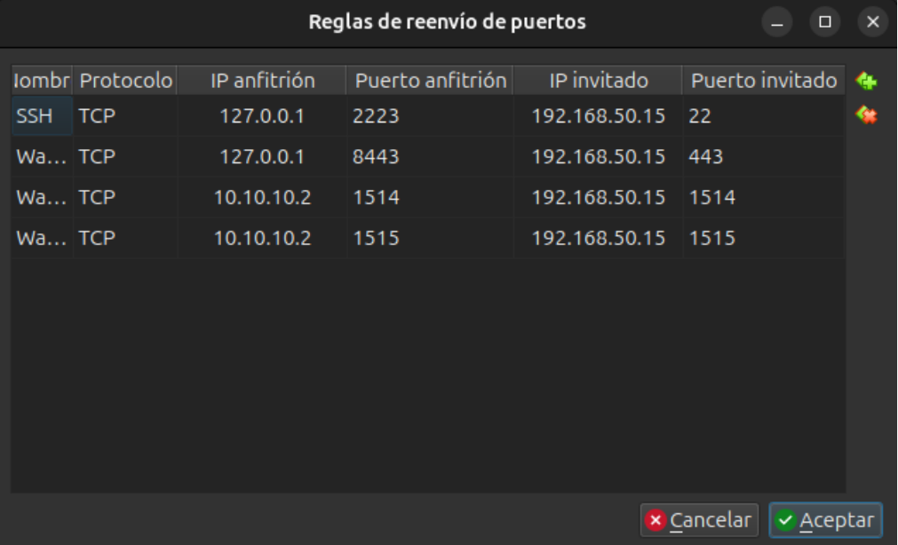
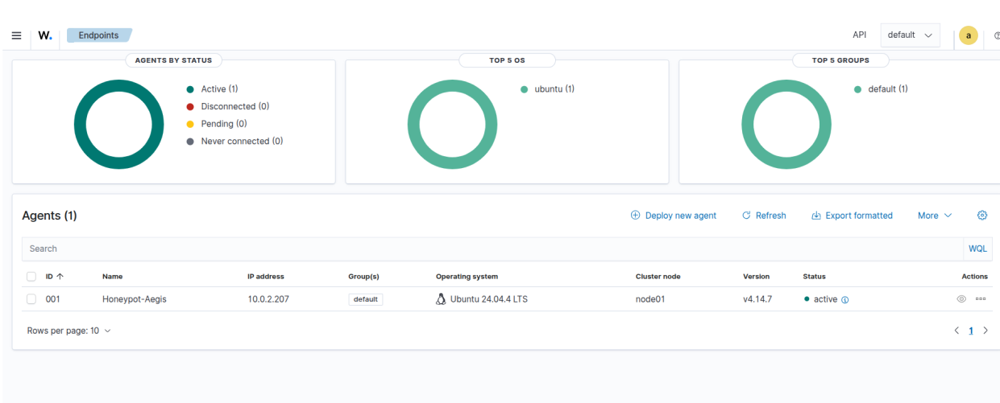
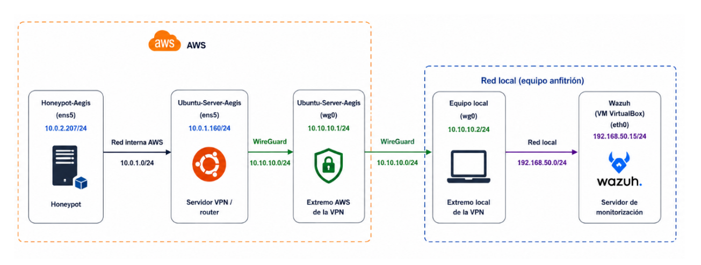

# Honeypot en AWS con Cowrie y Wazuh

Proyecto de ciberseguridad centrado en el despliegue de un honeypot
en AWS para exponer servicios señuelo a Internet y registrar la
actividad recibida.

El laboratorio combina un servidor Ubuntu en AWS con **Cowrie** como
servicio SSH señuelo y **Nginx** como servicio web. Los eventos se
centralizan en un servidor **Wazuh** situado en el entorno local.

La comunicación entre AWS y el entorno local se realiza mediante
**WireGuard**, evitando exponer directamente el servidor Wazuh a
Internet.

## Objetivos

- Diseñar la infraestructura del laboratorio en AWS.
- Desplegar servicios señuelo accesibles desde Internet.
- Separar el acceso SSH administrativo del servicio SSH de Cowrie.
- Comunicar AWS con el entorno local mediante WireGuard.
- Centralizar los eventos generados por el honeypot en Wazuh.
- Preparar la infraestructura para una posterior fase de análisis.

## Arquitectura


El laboratorio se divide en dos entornos principales:

**AWS**
- Instancia Ubuntu Server.
- Cowrie como servicio SSH señuelo.
- Nginx como servidor web.
- Agente Wazuh.

**Entorno local**
- Wazuh Manager.
- Wazuh Indexer.
- Wazuh Dashboard.

Ambos entornos se comunican mediante una VPN **WireGuard**, permitiendo enviar los eventos del honeypot hacia Wazuh sin exponer el servidor de monitorización directamente a Internet.

## Tecnologías utilizadas

`AWS` `Ubuntu Server` `Cowrie` `Nginx` `Wazuh` `WireGuard` `DNS` `HTTPS/TLS` `iptables` `systemd`

## Infraestructura en AWS

Para el laboratorio se utilizó una VPC en AWS con diferentes subredes para separar los componentes de la infraestructura.

El honeypot se desplegó en una instancia **Ubuntu Server**, permitiendo desde Internet únicamente el tráfico necesario para los servicios señuelo.


El tráfico se controló mediante **Network ACL y Security Groups**, permitiendo el acceso público a:

- **22/TCP** → servicio SSH señuelo de Cowrie.
- **80/TCP** → servicio web HTTP.
- **443/TCP** → servicio web HTTPS.

El acceso administrativo real al servidor se mantuvo separado del servicio SSH expuesto.

##  Servicio web señuelo

En la misma instancia se instaló **Nginx** para publicar una página web ficticia accesible desde Internet.

Se configuró resolución DNS y posteriormente se habilitó **HTTPS mediante un certificado TLS de Let's Encrypt**.


Las peticiones recibidas por Nginx quedaban registradas para poder analizarlas posteriormente mediante Wazuh.

##  Honeypot SSH con Cowrie

Para simular un servicio SSH vulnerable se instaló **Cowrie** utilizando un usuario específico y un entorno virtual de Python.


Cowrie escuchaba internamente en el puerto **2222**, mientras que las conexiones procedentes de Internet llegaban al puerto estándar **22**.

Mediante una regla de `iptables`, el tráfico recibido en el puerto 22 se redirigía hacia Cowrie:

```bash
sudo iptables -t nat -A PREROUTING -p tcp --dport 22 -j REDIRECT --to-ports 2222

```

El servicio SSH real utilizado para administrar el servidor se trasladó al puerto 22222, manteniéndolo separado del honeypot.

## Comunicación mediante WireGuard

Para comunicar la infraestructura de AWS con el entorno local se utilizó una VPN **WireGuard**.

El servidor de AWS utilizado como punto de conexión permitía que el honeypot se comunicara con el servidor Wazuh local sin necesidad de exponer directamente el sistema de monitorización a Internet.



Durante el despliegue también fue necesario configurar el enrutamiento entre las diferentes redes para permitir la comunicación entre AWS, WireGuard y el entorno local.

## Integración con Wazuh

Para centralizar los eventos se desplegó **Wazuh** en una máquina virtual independiente con Ubuntu Server.

La instalación incluía:

- Wazuh Manager
- Wazuh Indexer
- Wazuh Dashboard

Después se instaló el **agente Wazuh** en el honeypot de AWS y se configuró su comunicación con el servidor local a través de WireGuard.



Una vez realizada la configuración, el honeypot apareció bien registrado en Wazuh y quedó preparado para enviar los eventos generados por los servicios señuelo.

## Resultado final

La infraestructura quedó formada por un honeypot desplegado en AWS con **Cowrie** como servicio SSH señuelo y **Nginx** como servicio web.

El acceso administrativo se mantuvo separado del servicio SSH expuesto y la comunicación con Wazuh se realizó mediante WireGuard.



Las pruebas permitieron comprobar que los servicios eran accesibles desde Internet y que la actividad generada podía registrarse y centralizarse en Wazuh.

Esta infraestructura quedó preparada para una segunda fase del proyecto centrada en el **análisis de la actividad y los ataques recibidos desde Internet**.

## Conocimientos puestos en práctica

- Diseño de redes en AWS.
- Administración de servidores Linux.
- Configuración de servicios HTTP/HTTPS.
- DNS y certificados TLS.
- Configuración y administración de Cowrie.
- Gestión de puertos y reglas con iptables.
- VPN y enrutamiento mediante WireGuard.
- Instalación y configuración de Wazuh.
- Resolución de problemas de red y servicios.

## Documentación

La documentación completa del despliegue incluye la configuración y las pruebas realizadas durante el proyecto.

**Memoria completa del proyecto:** En el directorio Docs de este repositorio.
